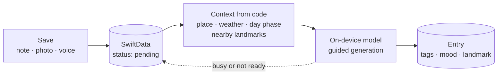
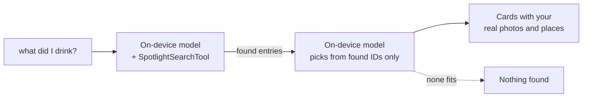

# Travel Journal AI

A travel journal for iPhone that understands your memories on device.

You capture a moment in a tap or two: a note, a photo, a voice message. The app saves it right away. Then Apple's
on-device model quietly tags it, so later you can find it by asking in plain words: *"the black ice cream"*,
*"best views from my Norway trip"*.

> A learning project about AI inside iOS apps: on-device, cloud and the line between them.
> Work in progress. The numbers below are real measurements, not claims.

## Principles

- **Save first, enrich after.** Saving never waits for a model. Tags arrive afterwards. If the model fails, the
  memory is still there, and indexing is retried on the next launch.
- **Capture silently, answer on demand.** The app never replies to what you write. AI only speaks when you ask.
- **Facts come from code, judgement from the model.** Date, place, weather and nearby landmarks are looked up by code
  and given to the model as context. The model only picks from what it sees and what it was given.
- **On device by default.** Nothing goes to a cloud model unless you ask for it, and the UI says so.

## How an entry gets indexed



- **Guided generation with a dynamic schema.** The output schema is built per entry. The landmark is an `anyOf` of
  the places MapKit actually found nearby (plus `none`), so the model can't invent one. Mood is only asked for when
  there is a written note.
- **Voice notes** are transcribed on device with Speech. The audio is the memory; the transcript is for search.
- **Errors are translated into a retry policy** in the Domain layer: "the model is busy" leaves the entry pending,
  "this note is too long" or "unsupported language" marks it failed and the UI says why.
- **Tags stream in live** while you stay on the screen. Partial results live in memory only; the store is written
  once, with the finished index.
- **Categories for search.** Besides specific tags, the model picks up to four categories from a fixed list of 38
  (food, drink, beach, train…), and the device's weather and time of day are indexed as plain words.

## How search works



Every entry is indexed in Core Spotlight. **Retrieval**: the model turns the question into Spotlight queries through
`SpotlightSearchTool`, and the app collects the IDs of what the tool returned. **Selection**: a second call chooses
among those IDs only, through a schema that lists nothing else, or chooses none. The model never writes an ID, so a
result always opens a real memory.

## Trip story

Opening a trip shows its memories by day and a **Tell the story** button. The on-device model writes a short story
and picks highlights, again only from the trip's own entries. The story is stored with a fingerprint of the entries,
so it opens instantly next time and offers an update once something changed. It never writes on its own: every story
is a tap. Private Cloud Compute will write longer, richer stories once the entitlement is granted; the writer sits
behind a protocol, so only the composition root changes.

## What I measured

Photos: 20 of my own travel photos on an iPhone 17 with iOS 27. Notes: 13 notes × 3 runs on the Mac. Search and
stories: my own journal on the same iPhone. Details, raw tables and what each run taught me:
[photo eval](Evaluation/PhotoEval/README.md) · [prompt lab](Evaluation/PromptLab/README.md) ·
[search eval](Evaluation/SearchEval/README.md) · [story eval](Evaluation/StoryEval/README.md).

| Question | Answer |
|---|---|
| How long does indexing a photo take? | ~2 s, ~550 input tokens |
| Does the model get the mood right without a note? | 10/20 when asked. 20/20 once mood is simply not asked for |
| Does telling it "name things only when sure" stop invented names? | No. It can't tell when it's sure |
| Does writing tags in English help search? | Yes, the one clear gain: labels in Japanese became searchable words |
| Is `OCRTool` worth it for photos? | No: 3.4× slower, timeouts on photos without text, no better tags |
| How noisy is a 20-photo eval? | ±1–2 points between identical runs. Most prompt tweaks are inside that |
| Does streaming make tagging faster? | No. It shows the first tag sooner; most of the wait is before the first token |
| How does the search tool match? | Literally: "views" misses "view", "drink" misses "juice". The small model rarely tries other words |
| What fixed search? | Meaning in the index, not the query: categories and weather words took it from 4/9 to 8/9 questions found |
| Does search ever show a wrong memory? | Not in any run: grounding the answer in the found IDs held, and "nothing found" was always right |
| How long does a search take? | ~1.3 s: retrieval ~1 s, selection ~0.35 s |
| How long does an on-device trip story take? | ~3.6 s for a short trip, with highlights only from real entries |

## Status

- [x] Foundations: model availability, trips, save without AI
- [x] Silent indexing of text: guided generation, mood, error handling
- [x] Photos and context: image input, weather, nearby landmarks with a dynamic schema, OCR experiment
- [x] Voice notes with on-device transcription
- [x] Live tags while you watch
- [x] Search across memories (Core Spotlight, local RAG), with an on-device eval
- [x] Trip screen with an on-device story
- [ ] Editable tags, trip mosaic
- [ ] Trip story and "ask about this memory" with Private Cloud Compute (waiting for the entitlement)
- [ ] Evaluation across models

## Architecture

```
TravelJournal/                 App target: composition root, Debug-only eval runners
Packages/TravelJournalKit/
  Sources/Domain/              Entities, use cases, protocols. No Apple data frameworks
  Sources/DataLayer/           SwiftData, location, weather, MapKit, Speech, Foundation Models
  Sources/Presentation/        SwiftUI views and view models
  Tests/                       Swift Testing suites per layer
Packages/DesignSystem/         Tokens and components ("sky by hour" colours)
Evaluation/
  PromptLab/                   Scores prompt changes against the real model on the Mac
  PhotoEval/                   Runs the app's indexer on photos on a real iPhone
  SearchEval/                  Runs search on the iPhone's own journal
  StoryEval/                   Writes every trip's story on the iPhone
```

Dependencies point inwards: `Presentation → Domain ← DataLayer`. Foundation Models types never leave DataLayer, so
the indexing and retry logic is tested without a model.

## Running it

Requirements: Xcode 27 with the iOS 27 SDK, and an iPhone with Apple Intelligence turned on. The simulator runs the
app and text indexing, but has no image model, and search and stories failed there: the evals run on the iPhone.

1. Copy `Config/Signing.local.example.xcconfig` to `Config/Signing.local.xcconfig` and set your team ID and bundle ID.
2. Open `TravelJournal.xcodeproj` and run the `TravelJournal` scheme.

Tests:

```bash
xcodebuild test -project TravelJournal.xcodeproj -scheme TravelJournal -destination 'platform=iOS Simulator,name=iPhone 18 Pro'
```

## Privacy

Indexing, search and stories run on the phone. Notes, photos, transcripts and tags never leave it. No API keys ship
in the app. Entries are in the phone's Spotlight index, so they also show up in the system search, on the phone only.

What does leave the phone when you save an entry, only if location is allowed and there is a network:

| Data | Sent to | Why |
|---|---|---|
| Coordinates | Apple Maps (MapKit) | Place name, and landmarks within 300 m |
| Coordinates | [Open-Meteo](https://open-meteo.com) (no account, no key) | Weather, sunrise and sunset at that moment |

Nothing else is sent: no text, no tags, no identifiers.

The photos and journals used in the evaluations are personal: they and the reports quoting them are not in this
repository.

## License

[MIT](LICENSE)
